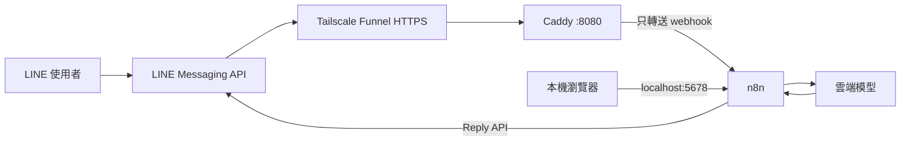

# LINE 聊天機器人

### Windows + Docker Compose + n8n + Funnel + 雲端模型

規劃與兩階段驗證

---

## 需求很精簡

- 像新認識的朋友，自然回覆文字
- 每則訊息都是新對話，不帶入前文
- 只處理文字
- 貼圖、圖片、音訊等不回覆

---

## 架構：管理介面留在本機

Caddy 不轉送編輯器路徑，Funnel 不公開 5678。

---

## 每則訊息的流程

1. LINE webhook 抵達 Funnel
2. 驗證原始 body 的 LINE 簽章
3. 只挑文字事件，其餘停止
4. 僅將當則文字送給模型
5. 用 `replyToken` 回覆
6. 以 `webhookEventId` 短期去重重送事件

---

## 「不記憶」也要避免執行紀錄留內容

- 模型輸入不附對話歷史
- 不建立聊天紀錄或使用者資料庫
- 關閉 n8n 成功、失敗與手動執行內容保存
- 日誌不輸出訊息、prompt、回答或金鑰
- 模型供應商仍會收到當則文字；先確認其資料條款

---

## 元件與費用

| 元件 | 工作 | 費用注意 |
|---|---|---|
| Docker Compose / n8n | 本機流程引擎 | 自架，PC 需持續運作 |
| Caddy + Funnel | 只公開 webhook | Funnel 有 beta、頻寬與政策限制 |
| LINE Messaging API | 收發訊息 | 依官方帳號地區/方案確認額度 |
| Gemini API 等 | 生成回答 | 免費額度、配額與資料條款會變動 |

免費額度不等於保證零成本或全天候可用。

---

## 第一階段：本機整合

**測試**

- 有效與無效簽章
- 文字、貼圖、圖片、多事件 payload
- 模型逾時與 API 錯誤
- 不相關文字是否彼此獨立
- n8n execution data / 日誌是否留有訊息內容

**通過**：文字只回覆一次；非文字與無效簽章不呼叫模型、不回覆；沒有內容留存。

---

## 第二階段：LINE 小範圍實測

- LINE Developers Console 驗證 Funnel webhook URL
- 測試多則互不相關文字與非文字訊息
- 檢查回覆、重送去重、錯誤恢復及模型用量
- 確認 Funnel 根路徑看不到 n8n 編輯器

**通過**：LINE 訊息行為符合需求，無重複回覆，錯誤時可恢復。

---

## 目前進度與下一步

- Docker Compose：n8n 與 Caddy 已在本機啟動
- n8n 管理員、LINE workflow 與 API 憑證：尚待設定
- Tailscale/Funnel：尚未安裝/啟用
- 兩階段測試：尚未執行

**下一步**：建立 n8n owner → 設定 Tailscale Funnel → 加入 Credentials → 建 workflow → 先本機測試

---

## 官方參考

- [LINE webhook 與簽章驗證](https://developers.line.biz/en/docs/messaging-api/verify-webhook-signature/)
- [Tailscale Funnel](https://tailscale.com/docs/features/tailscale-funnel)
- [n8n 執行資料設定](https://docs.n8n.io/deploy/host-n8n/configure-n8n/basic-configuration/use-environment-variables/executions/)
- [Gemini API 定價](https://ai.google.dev/gemini-api/docs/pricing)
- [HackMD 投影片語法](https://hackmd.io/how-to-create-slide-deck-tw)
