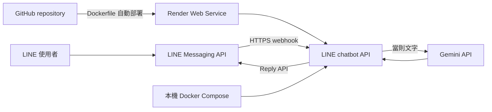

# LINE 聊天機器人

### Render + Docker + Gemini

無記憶，只處理文字

---

## 需求

- 像新朋友一樣自然對話
- 每則文字訊息都獨立處理
- 不保存或傳送聊天歷史
- 貼圖、圖片、音訊等非文字事件不回覆

---

## 架構：小型 Python webhook

此版本不使用 n8n；Render Web Service 提供 HTTPS，Compose 用於本機開發。

---

## 收件與回覆流程

1. 以原始 body + `x-line-signature` 驗證 HMAC-SHA256
2. 無效簽章回 400，不呼叫外部 API
3. 有效事件先快速回 200 ACK
4. 只挑 `message.type=text` 事件
5. 當則文字交給 Gemini，不帶前文
6. 使用 `replyToken` 呼叫 LINE Reply API

---

## 不記憶與秘密管理

- 不建立聊天資料庫或持久對話記憶
- 僅以短期記憶體 event ID set 避免重送；不保存訊息本文
- 日誌不輸出訊息、prompt、模型回答或金鑰
- LINE/Gemini 金鑰放 Render Dashboard Environment
- GitHub Secret 不會自動成為 Render 環境變數

---

## 免費方案限制

- Render Free Web Service 閒置 15 分鐘後休眠
- 首個請求喚醒可能約需一分鐘
- LINE webhook 大約兩秒內要收到 HTTP 2xx
- 冷啟動可能造成 webhook timeout 或重送
- 免費方案適合嘗試，不保證即時或全天候可用

穩定服務需評估常駐付費服務或快速 ACK + 持久佇列架構。

---

## 第一階段：本機整合

- Compose 啟動後 `/healthz` 回 200
- 測有效/無效簽章與文字/非文字事件
- 確認先 ACK，再處理 Gemini/LINE 回覆
- 測 event ID 去重與對話獨立
- 檢查日誌不含內容與秘密

---

## 第二階段：Render + LINE

- 從 GitHub 部署 Render Docker Web Service
- 設定 Render secrets，驗證 `/healthz`
- LINE Developers Console 設 Webhook URL 並 Verify
- 測互不相關文字及貼圖/圖片/音訊
- 觀察冷啟動、webhook timeout、重送及模型用量

---

## 待辦

- 核心 unittest 與本機 HTTP smoke test 已通過
- 部署 Render service 並設定 Render 環境變數
- 取得 LINE Channel Secret / Access Token
- 完成實際 Gemini/LINE 整合測試及第二階段 LINE 實測

---

## 官方參考

- [Render Web Services](https://render.com/docs/web-services)
- [Render 免費方案](https://render.com/docs/free)
- [Render 環境變數](https://render.com/docs/configure-environment-variables)
- [LINE webhook 簽章](https://developers.line.biz/en/docs/messaging-api/verify-webhook-signature/)
- [LINE webhook timeout](https://developers.line.biz/en/docs/messaging-api/check-webhook-error-statistics/)
- [Gemini API](https://ai.google.dev/gemini-api/docs)
