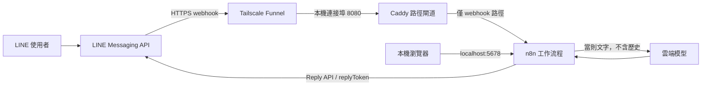

# LINE 聊天機器人設計與實作計畫

更新日期：2026-10-16

## 1. 目標與範圍

建立一個簡單、像朋友般自然對話的 LINE 聊天機器人。每則訊息獨立交給雲端語言模型，不保存或傳入前文。只處理文字訊息；貼圖、圖片、音訊、影片及其他非文字訊息不回覆。

### 本期不做

- 不建立對話記憶、使用者個人檔案、知識庫或聊天紀錄。
- 不辨識貼圖或多媒體、不做語音轉文字。
- 不處理群組特殊邏輯、管理後台或付費功能。
- 不把本機 n8n 編輯器公開到網際網路。

## 2. 現況

- Windows PC 已安裝 Docker；目前 Docker Engine 29.8.2、Compose 5.6.0 可使用。
- `compose.yaml` 已啟動 n8n 與 Caddy webhook gateway；本機 n8n 健康端點回應 200，Caddy 根路徑回應 404。
- n8n 編輯器只綁定 `127.0.0.1:5678`；Caddy 只轉送 `/webhook/*` 和 `/webhook-test/*` 至 n8n。
- 尚未建立 LINE 工作流程，尚未設定 LINE 或模型憑證；目前環境未找到 Tailscale CLI，Funnel 尚未啟用。
- 尚未完成本機整合測試或 LINE 實測。

## 3. 架構



### 元件與責任

| 元件 | 用途 | 設計要點 |
|---|---|---|
| LINE Messaging API | 傳入訊息事件及提供回覆 API | 啟用 webhook；先驗證簽章；只回覆文字訊息 |
| Tailscale Funnel | 將本機服務以 HTTPS 暴露給 LINE | Funnel 指向 Caddy 的 8080；不可公開 n8n 的 5678 |
| Caddy | 對外路徑閘道 | 只允許 `/webhook/*`、`/webhook-test/*`；其他路徑 404 |
| n8n | 接收事件、篩選、呼叫模型及回覆 | Docker Compose 執行；SQLite 與設定存在 named volume |
| 雲端模型 | 產生自然語言回答 | 每次只傳當前文字；限制輸出長度；不啟用對話歷史 |

## 4. 單則訊息處理流程

1. LINE 將 webhook POST 到 Funnel HTTPS 主機名稱下的 n8n production webhook URL。
2. n8n 取得原始 request body 與 `x-line-signature`，依 LINE Channel Secret 以 HMAC-SHA256 驗證。簽章不符時停止流程，不呼叫模型、不回覆。
3. 對 webhook 中的事件逐一檢查：只有 `type=message` 且 `message.type=text` 才繼續；其他事件正常結束、不回覆。
4. 將當則文字與固定的「友善、自然、簡潔」系統指示送給模型；不得附加先前訊息或使用者對話記錄。
5. 將模型回答以 LINE Reply API 和該事件的 `replyToken` 回傳。
6. 模型逾時、配額耗盡或 API 錯誤時，回覆固定的簡短暫時無法服務訊息，避免洩露內部錯誤；錯誤紀錄不得包含訊息本文或憑證。

LINE 可能重送 webhook，因此正式流程應以 `webhookEventId` 做短期去重，避免同一事件重複呼叫模型或重複回覆。去重資料只保留事件 ID 與到期時間，不含訊息本文或對話內容。

## 5. 無記憶與資料保護

「不記憶」不只是不把歷史傳給模型，也要避免 n8n 儲存含訊息本文的執行資料。n8n 執行紀錄預設可能保存成功及失敗的執行內容，因此正式啟用前應在 Compose 設定：

```yaml
EXECUTIONS_DATA_SAVE_ON_SUCCESS: none
EXECUTIONS_DATA_SAVE_ON_ERROR: none
EXECUTIONS_DATA_SAVE_MANUAL_EXECUTIONS: "false"
EXECUTIONS_DATA_SAVE_ON_PROGRESS: "false"
```

並確認日誌不印出 webhook 本文、模型 prompt/response、LINE token 或模型 API key。操作紀錄應以狀態碼、耗時、事件 ID（可雜湊）及錯誤類型為主。n8n 必要的工作流程、憑證加密金鑰與設定仍保存在本機 volume；這些不是對話記憶，但需納入備份與存取控制。

雲端模型服務會收到每則使用者文字；模型供應商對免費層的資料使用、保留政策與配額依帳號及模型而異。上線前應檢視供應商條款，不要傳送敏感個資。Gemini API 可作為免費額度候選，不能假定配額永遠免費或固定。

## 6. 金鑰與設定

- `N8N_ENCRYPTION_KEY` 留在本機 `.env`，保持固定且備份；遺失可能使已儲存的 n8n 憑證無法解密。
- LINE Channel Secret、Channel Access Token 與模型 API Key 優先建立為 n8n Credentials。
- `.env`、含秘密的匯出檔、執行紀錄及使用者訊息不得提交版本控制。
- Funnel HTTPS 主機名稱確認後，更新 `.env` 的 `N8N_WEBHOOK_URL` 並重啟 Compose；LINE Developers Console 註冊 Webhook node 顯示的 production URL，不是 n8n 首頁網址。
- 目前映像採 `latest` 標籤；穩定運作後應選定並固定版本，升級前備份 n8n volume 並於測試流程驗證。

## 7. 費用與限制

| 項目 | 預期成本 | 需留意 |
|---|---|---|
| Docker Compose / 自架 n8n | 軟體可自架；需有長時間開機的 PC、電力及網路 | Funnel / LINE 都依賴 PC 與網路可用；檢查 n8n 授權及用途條款 |
| Tailscale Funnel | 目前官方文件列為各方案可用，功能仍為 beta | 有連接埠、網域政策與頻寬限制；不可視為正式服務 SLA |
| LINE Messaging API | 依 LINE 官方帳號地區與方案計費 | 免費訊息額度、超量規則需在建立帳號時確認 |
| 雲端模型 API | 視所選模型免費額度或用量計價 | 免費模型的速率、每日額度、資料條款可能變更 |

整體目標是以免費層與自架降低費用；不承諾永遠零成本或全天候可用。

## 8. 實作步驟

1. 在 `http://localhost:5678` 完成 n8n 管理員帳號初始設定。
2. 在 Windows 安裝並登入 Tailscale；確認 tailnet 已允許 Funnel，使用 `tailscale funnel 8080` 開啟 Caddy 入口。
3. 將 Funnel HTTPS 主機名稱寫入本機 `.env` 的 `N8N_WEBHOOK_URL`，執行 `docker compose up -d` 套用設定。
4. 在 n8n 建立 LINE 與雲端模型 Credentials；確認不在 workflow 欄位明文填入秘密。
5. 建立 LINE webhook workflow：Webhook（Raw Body）→ 驗證 LINE 簽章 → 拆分/檢查事件 → 非文字停止 → 事件去重 → 模型 → LINE Reply API。
6. 將執行資料保存設定改為不保存本文，並用流程紀錄確認沒有 prompt、response 或 webhook 本文被寫入。
7. 完成本機階段測試後，再到 LINE Developers Console 設定 production webhook URL 並執行 Verify。
8. 小範圍完成 LINE 實測，確認成功率、回覆時間、錯誤及模型用量，再評估是否擴大。

## 9. 兩階段測試與驗收條件

### 第一階段：本機整合測試

**做法**

- 使用合成 webhook 測試有效與無效簽章；測試資料不可含真實使用者個資。
- 傳入文字、貼圖、圖片及多事件 payload；檢查各分支與模型呼叫次數。
- 模擬模型逾時/配額錯誤及 LINE 回覆 API 錯誤。
- 檢查 SQLite 執行資料、n8n UI 與 Docker 日誌，確認沒有訊息本文或模型內容被保存或輸出。
- 連續送出語意不相關的文字，檢查每次模型輸入只含當則訊息及固定系統指示。

**通過條件**

- 正確簽章的文字事件收到一則 LINE 格式回覆；錯誤簽章不進模型、不回覆。
- 非文字事件不呼叫模型且不回覆。
- 重送相同 `webhookEventId` 不會重複產生模型回覆。
- n8n execution data 與日誌不保留訊息本文、prompt、response 或秘密。
- 模型故障會回傳簡短固定錯誤訊息，不洩漏供應商錯誤內容。

### 第二階段：LINE 小範圍實測

**做法**

- 由 LINE Developers Console 的 Webhook URL Verify 確認 Funnel HTTPS 路由可達。
- 用一個測試 LINE 帳號先後傳送多則互不相關文字，再傳送貼圖、圖片及音訊。
- 觀察 LINE 回覆、n8n 工作流程狀態、Docker 日誌及模型用量；不記錄聊天本文。
- 至少測試一次暫時切斷模型 API 或使用無效模型金鑰的錯誤處理，完成後還原設定。

**通過條件**

- LINE Verify 成功；一般文字能收到一則回覆，且後一則回答不沿用前一則內容。
- 非文字訊息不回覆；失敗或重送事件不造成重複訊息。
- 無法連線、模型限流或 API 錯誤時，使用固定錯誤回覆且服務可恢復。
- 確認 n8n 編輯器仍只能從本機存取，Funnel 根路徑不提供管理介面。

## 10. 目前待辦

- [ ] 建立 n8n owner 帳號。
- [ ] 安裝並登入 Tailscale，啟用 Funnel。
- [ ] 建立 LINE Messaging API channel 與雲端模型 API key。
- [ ] 更新 Compose，停用執行資料保存並固定映像版本。
- [ ] 建立並匯入/啟用 workflow，設定 n8n Credentials。
- [ ] 完成本機整合測試。
- [ ] 完成 LINE 小範圍實測。

## 參考資料

- [LINE 接收 webhook](https://developers.line.biz/en/docs/messaging-api/receiving-messages/)
- [LINE 驗證 webhook 簽章](https://developers.line.biz/en/docs/messaging-api/verify-webhook-signature/)
- [LINE 傳送訊息](https://developers.line.biz/en/docs/messaging-api/sending-messages/)
- [Tailscale Funnel 官方文件](https://tailscale.com/docs/features/tailscale-funnel)
- [n8n 執行資料環境變數](https://docs.n8n.io/deploy/host-n8n/configure-n8n/basic-configuration/use-environment-variables/executions/)
- [Gemini API 定價與免費額度](https://ai.google.dev/gemini-api/docs/pricing)
- [HackMD 建立投影片](https://hackmd.io/how-to-create-slide-deck-tw)
