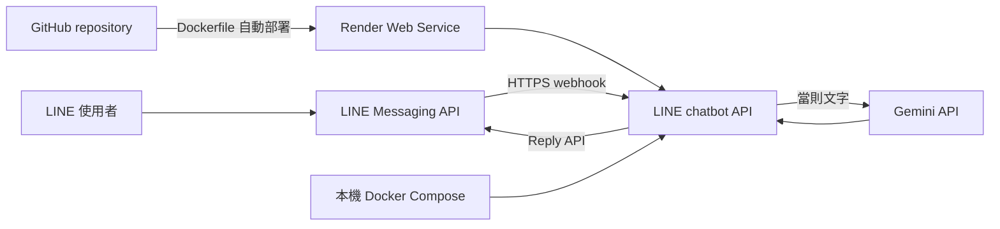

# LINE 聊天機器人設計與實作計畫（Render）

更新日期：2026-10-16

## 目標與範圍

以免費資源嘗試建立簡單的 LINE 文字聊天機器人。Render Web Service 提供公開 HTTPS webhook；服務以 Dockerfile 建置 Python API，呼叫 Gemini 產生簡短回答，並透過 LINE Reply API 回覆。Docker Compose 用於本機執行同一個服務。此方案暫停 n8n。

- 每則文字訊息獨立處理，絕不傳入前文或保存對話記憶。
- 貼圖、圖片、音訊及其他非文字事件不回覆。
- 驗證 LINE 簽章；不記錄原始訊息、提示詞、模型回答或金鑰。
- 不建置對話資料庫、使用者檔案、知識庫或管理後台。

## 架構

### 收件流程

1. FastAPI 取得原始 request body 及 `x-line-signature`，以 LINE Channel Secret 驗證 HMAC-SHA256。簽章錯誤回 400，不呼叫模型。
2. 驗證通過後，先回傳 200；於背景處理 webhook 事件，避免把 Gemini 延遲放在 LINE webhook HTTP 回應路徑上。
3. 只處理 `type=message` 且 `message.type=text` 的事件。其他事件略過。
4. 對 `webhookEventId` 做程序記憶體中的短期去重，避免常見重送造成重複回覆。此集合不含訊息本文，程序重啟後清空。
5. 只把當則文字和固定的友善簡潔指示送給 Gemini；呼叫成功後立即使用該事件的 `replyToken` 呼叫 LINE Reply API。
6. 模型或 LINE API 失敗時不記錄回應本文或憑證；只記錄錯誤類別。背景回覆失敗時由服務日誌顯示非敏感狀態，無法對已 ACK 的 webhook 再回固定錯誤訊息。

LINE 的 webhook ACK 需快速回覆，模型應在背景執行。Render 免費服務閒置 15 分鐘會休眠、喚醒約需一分鐘；休眠時首個 webhook 可能在服務啟動前逾時，且 LINE reply token 時效有限。因此免費 Render 只用於嘗試與小範圍測試，不保證實際對話可用。若冷啟動導致重送或 reply token 過期，需改用常駐付費服務，或把快速 ACK 與持久佇列移到常駐的 edge/queue 服務。

## 服務與設定

- `app/main.py`：FastAPI health check、原始 body 簽章驗證、非文字過濾與背景事件處理。
- `app/providers.py`：Gemini API 與 LINE Reply API 呼叫。
- `Dockerfile`、`requirements.txt`：Render 與本機共同使用的容器建置。
- `compose.yaml`：本機啟動服務，提供 `http://localhost:10000`。
- `render.yaml`：Render Blueprint 最小設定；不含秘密，秘密在 Render Dashboard 手動設定。
- `.env.example`：本機設定範本；不含真實秘密。

Render 服務應監聽 `0.0.0.0:$PORT`，提供不需憑證的 `/healthz`。環境變數：

| 名稱 | 用途 |
|---|---|
| `LINE_CHANNEL_SECRET` | 驗證 LINE webhook 簽章 |
| `LINE_CHANNEL_ACCESS_TOKEN` | 呼叫 LINE Reply API |
| `GEMINI_API_KEY` | Gemini 產生回覆 |
| `GEMINI_MODEL` | 模型名稱，預設 `gemini-3.1-flash-lite` |

Render 的 Environment Variables 與 GitHub repository secrets 分開管理；現有 GitHub Actions secret 不會自動提供給 Render。

## 金鑰與資料處理

- 僅把秘密放在未提交的本機 `.env` 或 Render Dashboard Environment Variables。
- 不得將秘密寫進 `render.yaml`、Dockerfile、程式碼、README、workflow 匯出或 GitHub 原始碼。
- Webhook 本文只留在請求記憶體中；不要輸出 body、當則文字、prompt、模型回答或 headers。
- 短期 event ID set 是防重送技術狀態，不是聊天記憶；不保存訊息本文，重啟清空。
- Gemini 會收到當前文字。免費層額度、資料政策、模型名稱與可用性可能改變，使用者須避免傳送敏感資料。

## 兩階段測試與驗收

### 第一階段：本機整合

- `docker compose up --build` 後 `/healthz` 回 200。
- 使用合成 payload 與有效/無效 HMAC 簽章測試 webhook。
- 確認有效文字事件在模型回應前即收到 200，並觸發一次 Gemini 與 LINE reply 呼叫。
- 確認貼圖、圖片及音訊事件不呼叫模型、不呼叫 Reply API；無效簽章不呼叫任何外部 API。
- 同一 `webhookEventId` 重送不重複呼叫模型；不同文字訊息的 Gemini 請求只包含當則文字。
- 檢查應用與容器日誌沒有訊息本文、prompt、模型輸出或金鑰。

### 第二階段：Render/LINE 小範圍實測

- 將程式碼推送至 GitHub，Render 從 repository 建置 Dockerfile，確認部署成功與 `/healthz` 正常。
- 在 Render Dashboard 設定三項必要秘密；不把 GitHub secret 當作 Render 的環境變數。
- 將 `https://<service>.onrender.com/webhook` 設為 LINE webhook URL，啟用 webhook 並使用 Verify。
- 用一個測試帳號送數則互不相關的文字及貼圖/圖片/音訊，確認只有文字得到回覆。
- 檢查 LINE webhook error statistics、Render 部署/應用日誌、Gemini 用量；確認沒有內容或秘密被記錄。
- 等服務休眠 15 分鐘，再送訊息，觀察冷啟動與 LINE webhook redelivery/reply-token 結果；不得將免費服務描述為即時穩定。

## 目前狀態與待辦

- [x] 本機 Docker 已安裝；舊 n8n/Caddy 容器已由新 Compose 移除，原 named volume 保留未動。
- [x] Gemini API key 已建立為 GitHub repository secret `GEMINI_API_KEY`；Render 仍須於 Dashboard 個別設定。
- [x] 建立 FastAPI webhook 服務與簽章/事件處理。
- [x] 將 Docker Compose 改為本機執行 chatbot API，新增 Dockerfile 與 Render Blueprint。
- [x] 核心本機測試：Docker unit test 4 項通過；`/healthz` 為 200、無效簽章為 400。
- [ ] 實際 Gemini/LINE 呼叫與有效真實 Channel Secret 簽章測試（尚未提供 LINE channel credentials）。
- [ ] 在 Render Dashboard 建立 Web Service 並設定 Gemini/LINE 環境變數。
- [ ] 完成第二階段 LINE 實測。

## 官方文件

- [Render Web Services](https://render.com/docs/web-services)
- [Render 免費執行限制](https://render.com/docs/free)
- [Render 環境變數與秘密](https://render.com/docs/configure-environment-variables)
- [LINE 接收 webhook](https://developers.line.biz/en/docs/messaging-api/receiving-messages/)
- [LINE 驗證 webhook 簽章](https://developers.line.biz/en/docs/messaging-api/verify-webhook-signature/)
- [LINE webhook 逾時錯誤](https://developers.line.biz/en/docs/messaging-api/check-webhook-error-statistics/)
- [Gemini API](https://ai.google.dev/gemini-api/docs)
